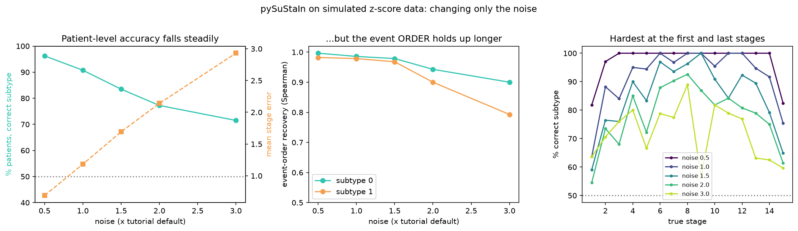

# SuStaIn toy experiment: what does noise do to subtype and stage inference?

Journal-club contribution (branch `dev-binoy`). Starting point: Taylor et al. (2024), *Data-driven neuroanatomical
subtypes of primary progressive aphasia*, Brain. This example runs the official
[pySuStaIn](https://github.com/ucl-pond/pySuStaIn) **z-score model on simulated data** (no patient data) and changes
one thing, the measurement noise, to see what SuStaIn still recovers. Because the data are simulated, the hidden
truth is known, so every result can be scored.

## SuStaIn in one paragraph
Each patient is scanned once, so the disease has to be reconstructed from snapshots. SuStaIn learns a few **routes**
(the order in which biomarkers become abnormal) and places each patient on one. **Subtype** = which route.
**Stage** = how far along it (number of abnormal events so far; not time, not severity). An *event* is one biomarker
crossing one severity level; in the paper, 19 brain regions x 3 w-score thresholds (1, 2, 3) = 57 events and 4 subtypes.

## Run it
Requires [uv](https://docs.astral.sh/uv/) (`brew install uv`, or `curl -LsSf https://astral.sh/uv/install.sh | sh`).
Needs network access once, to fetch packages and pySuStaIn from GitHub. Tested with Python 3.13 (3.11 to 3.13 allowed).

```bash
uv sync                                                    # creates .venv from pyproject.toml + uv.lock
uv run python codes/run_analysis.py --help
uv run python codes/run_analysis.py \
    --input input/synthetic_data.csv \
    --output output/                                       # about 2 minutes
```

Optional:
```bash
uv run pytest -q                                           # 15 fast tests, no model fitting (about 5 s)
uv run python codes/make_synthetic_data.py --output input/synthetic_data.csv   # regenerate the input (same seed = same file)
uv run python codes/noise_sweep.py                         # the experiment: 5 noise levels, about 10 minutes
uv run python codes/build_explorer.py                      # rebuild output/sustain_explorer.html from the sweep
uv run jupyter lab codes/walkthrough.ipynb                 # step-by-step version; set NOISE in the first code cell
```
Run every command from the repository root. Fits are stored in `output/_fit/` (git-ignored, deleted at the start of each run).

## Input: `input/synthetic_data.csv`
500 rows: 100 controls and 400 simulated patients, 5 biomarkers, 2 hidden subtypes (seed 0, noise 1 = the official tutorial's setting).

| Column | Type / units | Meaning |
|---|---|---|
| `subject_id` | text, unique | Row id (`S0000`...) |
| `group` | `control` or `patient` | Controls define "normal"; at least 20 are required |
| `biomarker_0` ... `biomarker_4` | number, arbitrary simulated units | One column per biomarker, no missing values. Any number of columns named `biomarker_<n>` works. Biomarkers that **decrease** with disease (e.g. brain volume) are detected and flipped automatically |
| `true_subtype` | integer 0/1, blank for controls | OPTIONAL hidden truth, only exists for simulated data |
| `true_stage` | integer 0 to 16 | OPTIONAL hidden truth. 0 = control; stage = number of events completed; 16 = end of disease |

`input/synthetic_data.truth.json` (optional, read automatically if it sits next to the CSV) holds the hidden event
orders (`gt_sequence`; event number = severity level index x 5 + biomarker index), the severity levels and the seed.
Real data only needs `subject_id`, `group` and the `biomarker_*` columns; give `--z-levels` and `--z-max` yourself.

Other files in `input/`: `synthetic_data_noise_<n>.csv` (+ `.truth.json`), the same cohort at noise 0.5, 1, 1.5, 2, 3.
**"Noise" definition:** the z-score model assumes controls have SD 1, so more noise is simulated by shrinking the
*signal*: every severity level and the end-of-disease z are divided by the noise factor. Noise 2 puts events at
z = 0.5, 1, 1.5 instead of 1, 2, 3 (same biology, half the signal-to-noise). The model is told the true levels.

## Output
| File | Content |
|---|---|
| `output/results.csv` | One row per subject: `subtype` (0 = most common), `prob_subtype`, `stage` (0 = looks like a control), `prob_stage`, `subtypable` (stage > 0), and when truth exists `true_subtype`, `true_stage`, `subtype_correct` |
| `output/sequences.csv` | The learned order of events per subtype: position, biomarker, severity level (`z_threshold`), probability |
| `output/metrics.json` | Settings, mean log-likelihood for 1/2/3 subtypes, accuracy against truth |
| `output/figures/positional_variance.png` | Paper's Fig. 1 style, ground truth beside SuStaIn's answer |
| `output/figures/stage_scatter.png`, `stage_distribution.png`, `data_scatter.png`, `mcmc_trace.png` | Stage accuracy, stage histogram, the data, sampler check |
| `output/noise_sweep/summary.csv`, `by_stage.csv`, `sweep.json` | Sweep results |
| `output/figures/noise_sweep.png` | The sweep figure |
| `output/sustain_explorer.html` | Interactive visual (single offline file): a clickable toy model, plus the real sweep results |

Expected console output of the command above (values vary by 1 to 2 points between runs, see caveats):
```
mean log-likelihood by number of subtypes: {'1': -4914, '2': -4481, '3': -4484}
vs truth: subtype accuracy 90.5%, mean stage error 1.19, event-order Spearman [0.98, 0.98]
```

## What I found
Same simulated cohort; only the signal-to-noise changes (`output/noise_sweep/summary.csv`).

| Noise | Subtype correct | Mean stage error (of 15) | Event-order recovery (Spearman, 2 subtypes) |
|---|---|---|---|
| 0.5 | 96.3% | 0.7 | 1.00 / 0.98 |
| 1.0 (tutorial) | 90.8% | 1.2 | 0.99 / 0.98 |
| 1.5 | 83.5% | 1.7 | 0.98 / 0.97 |
| 2.0 | 77.3% | 2.1 | 0.94 / 0.90 |
| 3.0 | 71.5% | 2.9 | 0.90 / 0.79 |

- Per-patient labels degrade steadily; the **order of events** holds up much longer.
- Subtype is least reliable at the first and last stages (`by_stage.csv`): early on both routes look "all normal", at the end both look "all abnormal". This may partly explain the fuzziness of the paper's S2/S3/S4.



## Gotchas (each cost me time)
1. **`ml_subtype` is numbered by prevalence (0 = most common); `samples_sequence` is not.** Compare them without re-ordering and the recovered sequences look swapped. See `aligned()` in `codes/run_analysis.py` and `AbstractSustain.subtype_and_stage_individuals`.
2. **numpy >= 2.4 breaks pySuStaIn's simulator** (`int()` of a 1-element array). `pyproject.toml` pins `numpy<2.4`.
3. **pySuStaIn lists two git-only dependencies** (`awkde`, `kde_ebm`) that only its mixture/KDE models need. `pyproject.toml` excludes them (`exclude-dependencies`) so `uv sync` works for the z-score model. pySuStaIn is pinned to a commit.
4. **SuStaIn silently reuses old results** found in its output folder. `fit_sustain()` deletes the work folder first.
5. **Defining "noise" matters.** Multiplying the noise and re-z-scoring against controls also rescales the signal and makes the model misspecified (my first sweep did this and gave nonsense).
6. `import sim` fails because of an old-style import in pySuStaIn; `make_synthetic_data.py` finds the folder and puts it on `sys.path`, as the official tutorial does.

## Caveats
- One simulated dataset and one run per noise level. Re-running gives slightly different numbers (the fit starts from random points; an earlier run of this same sweep gave 79% / 69% at noise 2 / 3, versus 77% / 72% here), so neighbouring noise levels are not statistically distinguishable.
- Seed 0 was chosen because its two true routes are clearly different (seed 1 had very similar routes, which is intrinsically harder).
- Tutorial speed settings (10 start points, 1e4 MCMC iterations), not the recommended 25 and 1e5+. No cross-validation (CVIC) was run, so "2 subtypes fit as well as 3" rests on mean MCMC log-likelihood only.
- The toy in Part 1 of the HTML is a JavaScript re-implementation of the scoring step with the true routes given; it is not pySuStaIn.

## Take-away and question for the lab
Researchers found four different patterns of brain shrinkage in a language-related dementia. Only one pattern clearly
matched a diagnosis, and the others overlapped, so the current diagnosis labels don't tell the whole story.

**Question:** What would you want to see in a follow-up study to know whether these four subtypes are real, and not just a product of the algorithm?
